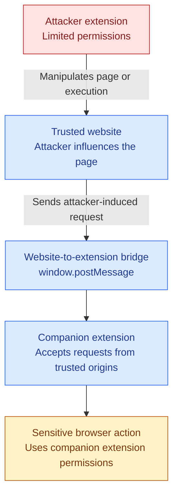
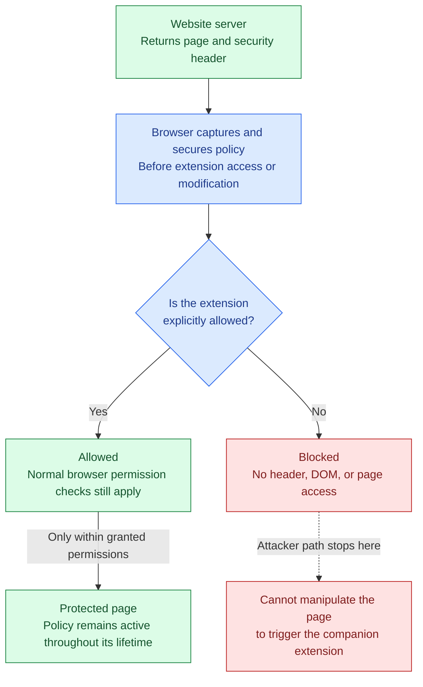

# Website Extension Access Policy

### A proposal to protect websites from unauthorized browser extensions

**Status:** Early proposal · **Scope:** Browser security · **Implementation:** Not yet implemented

> A website should be able to declare which extensions may access its pages.
> The browser should enforce that policy before any extension can read or
> modify the response headers, page content, or DOM.

## Why this matters

A website may use a companion extension to work with browser tabs, browsing
history, or other sensitive features.

The extension may accept requests only from the website's trusted domains.
However, another installed extension could manipulate that website and cause
it to send requests to the companion extension.

The attacker could then trigger actions beyond its own permissions.
**A trusted website address does not guarantee a trusted request.**

## How the attack works

| Component | What it can do |
| --- | --- |
| Trusted website | Send requests to its companion extension. |
| Companion extension | Perform sensitive browser actions using its permissions. |
| Attacker extension | Modify the trusted website, but lacks the sensitive permissions. |

The companion extension becomes a **confused deputy**: it uses its authority
on the attacker's behalf.

The exact attack depends on the implementation. DOM changes or script injection
may enable the request. Header changes may help weaken existing protections,
but header modification alone does not establish the full attack.

## Proposed protection

Introduce an HTTP response header through which a website identifies the
extensions allowed to access its pages.

**When the header is present, any extension not explicitly allowed must be
blocked from:**

- Reading or modifying the protected page or its DOM.
- Injecting scripts or replacing page content.
- Modifying the protected response's headers, including removing or weakening
  the security header itself.
- Using another extension API to bypass those restrictions.

The header name and syntax remain open for discussion.
This repository does not describe an existing browser feature or standard.

## How the browser would enforce it

The browser must capture the server's policy **before extensions can change
the response headers or access the page**, then retain it in browser-controlled
state. Removing a visible header must not remove the effective protection.

Existing extension permissions must not override the policy. Being allowed by
the website must not grant an extension any new permissions.

## Essential requirements

| Requirement | Expected behavior |
| --- | --- |
| Early enforcement | Apply protection before the first extension script or response modification. |
| Tamper resistance | Extensions cannot remove, replace, or weaken the effective policy. |
| Reliable identity | Verify allowed extension identities through the browser. |
| Complete coverage | Address frames, redirects, cached responses, and alternative access paths. |
| Trusted exceptions | Only explicit user or administrator controls can grant exceptions; extensions cannot grant themselves access. |

Exceptions would suspend protection for the permitted access. Their design must
consider accessibility tools, password managers, and other user-selected tools.

## Benefits and limits

The goal is to prevent an unauthorized extension from turning a trusted
website into a bridge to a more powerful extension.

This would not stop a compromised website or a malicious extension that the
policy explicitly allows. It would not revoke unrelated browser permissions
an extension already holds.

Companion extensions must still validate requests and limit sensitive actions.
Origin checks alone should not authorize unrestricted browser access.

## Next steps

1. Build a controlled demonstration with a website and two extensions.
2. Prototype browser enforcement of the policy.
3. Test header tampering, DOM access, injection, and alternative API bypasses.
4. Evaluate compatibility with legitimate extensions and user exceptions.

## Background and attribution

The motivating attack scenario was demonstrated at **Black Hat India 2026**
in the talk **“Attacking AI-Native Apps: Browsers, IDEs and More”** by
**Satyam Nagpal and Aman Sapra**.

This note presents a vendor-neutral description of that scenario and a proposed
browser defense. The proposed header and enforcement model are separate from
the referenced talk; no endorsement by its speakers is implied.

## Feedback welcome

Discussion is welcome on enforcement gaps, extension identity, user control,
compatibility, and related work. The proposal's novelty and security guarantees
remain to be established through research and implementation.
